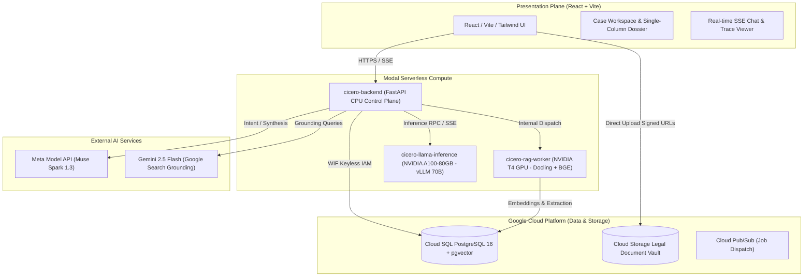
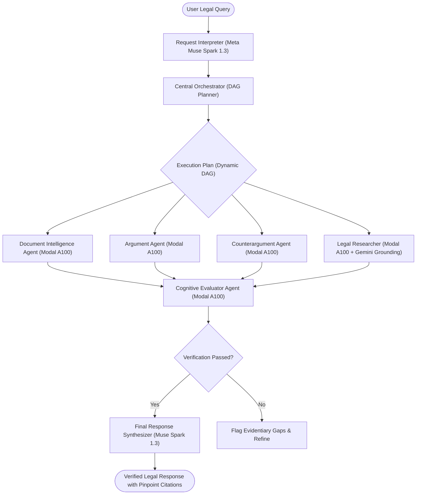
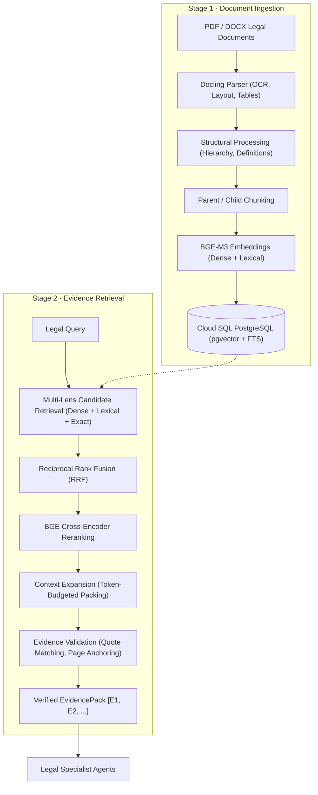

<div align="center">

# ⚖️ Cicero

### Enterprise Multi-Agent Legal Intelligence & Deliberation Platform

[](.github/workflows/ci.yml)
[](pyproject.toml)
[](apps/web/package.json)
[](https://modal.com)
[](deploy/gcp)
[](docs/architecture/repo-layout.md)
[](LICENSE)

<p align="center">
  <b>Cicero</b> is an autonomous multi-agent legal deliberation engine engineered for high-stakes litigation analysis. By combining structure-aware document parsing, hybrid RAG retrieval, adversarial agent deliberation on 70B open weights, page-anchored evidence verification, and Claude-style instruction skills, Cicero delivers provably grounded legal memorandums with zero tolerance for hallucinations.
</p>

[Key Features](#key-features) •
[System Architecture](#system-architecture) •
[Modal Serverless Topology](#modal-serverless-topology) •
[Agent Deliberation Pipeline](#agent-deliberation-pipeline) •
[Ingestion & Evidence Retrieval](#ingestion--hybrid-evidence-retrieval) •
[Token Clamping & Detokenization](#streaming-inference--token-clamping) •
[Two-Tier Verification](#two-tier-verification-harness) •
[Case Intelligence Persistence](#case-intelligence-persistence) •
[Quickstart](#quickstart) •
[Security & WIF](#security--keyless-identity)

---

</div>

## Overview

Modern Large Language Models produce persuasive legal arguments, but they struggle in high-stakes litigation where factual grounding, controlling authority hierarchies, and exact quote fidelity are paramount.

**Cicero solves this through structural separation, hybrid RAG, and adversarial multi-agent deliberation:**
1. **Evidence Before Opinion:** Agents cannot assert facts without pinned, page-anchored evidence extracted from parsed court pleadings, exhibits, and contracts.
2. **Adversarial Deliberation:** An **Argument Agent** constructs the affirmative case while an independent **Counterargument Agent** (powered by an independent model family) attacks factual weaknesses, affirmative defenses, and procedural vulnerabilities.
3. **Open-Weights 70B Reasoning on A100:** Core legal reasoning runs on **DeepSeek-R1-Distill-Llama-70B** hosted on an NVIDIA A100-80GB GPU via vLLM with AWQ quantization.
4. **Two-Tier Verification:** Deterministic Python algorithms check exact quote substrings and citation Bluebook formats before an **Evaluator Agent** judges substantive legal merit.
5. **Claude-Style Skills:** Specialized legal canons and authority classifications are maintained as standalone, versioned `SKILL.md` instruction packages.
6. **Permanent Enterprise Persistence:** Every case, document chunk, execution DAG trace, and Case Intelligence dossier is permanently stored in **Google Cloud SQL PostgreSQL** (`pgvector`), surviving browser refreshes and multi-user sessions.

---

## Key Features

- **📄 High-Fidelity Legal Ingestion:** Uses [Docling](https://github.com/DS4SD/docling) on GPU workers to parse complex, multi-column legal filings, docket sheets, exhibits, and deposition transcripts with full OCR and table reconstruction.
- **🔍 Structure-Aware Hybrid RAG:** Combines BAAI BGE-M3 dense and sparse representations with Reciprocal Rank Fusion (RRF), Cross-Encoder re-ranking, and parent-chunk context expansion against PostgreSQL `pgvector`.
- **⚔️ Multi-Model Adversarial Teams:** Eliminates correlated blind spots by pairing **Meta Muse-Spark 1.3** for interpretation/synthesis with **DeepSeek-R1-Distill-Llama-70B** on Modal A100 for adversarial debate, and **Gemini 2.5 Flash** for live Google Search grounding.
- **🛡️ Least-Privilege Agent Permissions:** Agents declare requested tools in declarative YAML manifests. The execution harness strictly enforces the intersection $\text{requested} \cap \text{granted}$ defined in central security policies.
- **⚡ Real-Time SSE Streaming:** Sub-second incremental token streaming (`POST /api/chat/stream`) with real-time agent lifecycle and tool-invocation events.
- **🔧 Dynamic Token Clamping & BPE Detokenization:** Dynamic token budgeter ($\text{input} + \text{output} \le 7,600$ tokens) ensures safety within the 8,192 vLLM context limit; 3-layer inverse byte detokenizer strips BPE artifacts (`Ġ` $\to$ space, `Ċ` $\to$ `\n`).
- **🔑 Zero Long-Lived Credentials:** Employs **Keyless Google Cloud Workload Identity Federation (WIF)** between Modal containers, Cloud SQL, and Cloud Storage signed URLs.

---

## System Architecture

Cicero is architected as a modular system cleanly divided into presentation, serverless compute, dedicated ML GPU inference, and an enterprise data plane.



---

## Modal Serverless Topology

The platform deploys across three specialized serverless applications on [Modal](https://modal.com):

| App Name | Hardware Profile | Responsibilities | Key Technologies |
| :--- | :--- | :--- | :--- |
| **`cicero-backend`** | Serverless CPU (Debian Slim, Python 3.12) | FastAPI REST API, SSE streaming gateway, Cloud SQL connection pool, agent orchestrator, task state machine. | FastAPI, SQLAlchemy 2.0, Asyncpg, Google Cloud SQL Connector |
| **`cicero-rag-worker`** | NVIDIA T4 GPU (16GB VRAM) | Document parsing, structural legal hierarchy extraction, BGE-M3 dense/lexical embeddings, BGE Cross-Encoder reranking. | IBM Docling, PyTorch, Hugging Face Transformers, pgvector |
| **`cicero-llama-inference`** | NVIDIA A100-80GB SXM GPU | High-throughput open-weights legal reasoning and document intelligence inference. | vLLM 0.6+, AWQ Quantization, FlashInfer, CUDA Graph Capture |

---

## Agent Deliberation Pipeline

Cicero rejects unconstrained ReAct loops in favor of a deterministic state machine managing a dynamic Directed Acyclic Graph (DAG):



### Specialized Execution Strategies

Following Anthropic's research on effective AI architectures, agents use strategies tailored to their cognitive role:

| Specialist Agent | Strategy | Hardware / Model | Guardrail & Token Budget |
| :--- | :--- | :--- | :--- |
| **Request Interpreter** | `single_shot` | Meta Muse-Spark 1.3 | Classifies legal intent, detects venue, clarifies ambiguities. |
| **Document Intelligence**| `map_reduce` | Modal A100 &bull; Llama 70B | Concurrent RAG extraction; clamps output to $\le 3,000$ tokens. |
| **Legal Researcher** | `tool_loop` | Modal A100 + Gemini 2.5 | Autonomous search across case discovery and statutory precedents. |
| **Argument Agent** | `single_shot` | Modal A100 &bull; Llama 70B | Builds affirmative legal thesis pinned to verified exhibits. |
| **Counterargument Agent**| `single_shot` | Modal A100 &bull; Llama 70B | Attacks factual premises, procedural defaults, and affirmative defenses. |
| **Evaluator Agent** | `single_shot` | Modal A100 &bull; Llama 70B | Evaluates controlling vs. persuasive authority weight over a `VerificationReport`. |
| **Synthesizer** | `single_shot` | Meta Muse-Spark 1.3 | Synthesizes verified multi-agent findings into a final court-ready response. |

---

## Ingestion & Hybrid Evidence Retrieval



---

## Streaming Inference & Token Clamping

To prevent vLLM context overflow on 70B models and ensure smooth UI streaming:

```mermaid
flowchart LR
    UserQuery["Legal Query"] --> WebUI["React Frontend"]
    WebUI -->|POST /api/chat/stream| FastAPI["FastAPI Gateway"]
    FastAPI --> ContextPrep["Context Preparation & System Instructions"]
    ContextPrep --> TokenBudgeter["Dynamic Token Budgeter (Input + Output <= 7,600)"]
    TokenBudgeter --> Gateway["Model Gateway"]
    Gateway --> vLLM["vLLM on Modal A100 (DeepSeek-R1-Distill-Llama-70B)"]
    vLLM --> Detokenizer["3-Layer Inverse BPE Detokenizer (0x20, 0x0A)"]
    Detokenizer --> SSE["SSE Stream (/api/chat/stream)"]
    SSE --> LiveRender["Live Markdown & Evidence Cards Rendered in UI"]
```



- **Dynamic Token Budgeter:** Clamps `safe_max_output = max(512, min(3000, int(7600 - estimated_input_tokens)))`, ensuring that prompt tokens and generation tokens never exceed the 8,192 hardware limit.
- **Inverse BPE Detokenization:** DeepSeek/Llama byte-level tokenizers emit raw byte sequences (`0x20 'Ġ'` for space, `0x0A 'Ċ'` for newline). Cicero incorporates a 3-layer detokenizer across the provider, API stream, and React component to eliminate corrupt tokens before rendering.

---

## Two-Tier Verification Harness

Cicero does not rely on an LLM to check its own work. Verification is strictly bifurcated:

```
┌────────────────────────────────────────────────────────┐
│  Agent Output: Claims, Quotes, Citations, References   │
└───────────────────────────┬────────────────────────────┘
                            │
                            ▼
┌────────────────────────────────────────────────────────┐
│  Tier 1: Deterministic Harness Validation (Python)     │
│  - QuoteMatcher: Exact character and substring match   │
│  - CitationValidator: Bluebook / Docket format check   │
│  - EvidenceResolver: Validates document IDs in DB      │
└───────────────────────────┬────────────────────────────┘
                            │
                            ▼ Emits VerificationReport (JSON)
┌────────────────────────────────────────────────────────┐
│  Tier 2: Cognitive Evaluator Agent (Llama 70B)         │
│  - Assesses legal sufficiency of propositions          │
│  - Weighs binding mandatory vs. persuasive authority   │
│  - Identifies evidentiary gaps and missing documents   │
└───────────────────────────┬────────────────────────────┘
                            │
              ┌─────────────┴─────────────┐
              ▼                           ▼
        [Sufficient]                [Insufficient]
    Approved for Synthesis      Evidentiary Gaps Flagged
```

---

## Case Intelligence Persistence

Case intelligence is permanently persisted and automatically restored across browser sessions:

- **Database Storage:** Outputs from `POST /api/cases/{case_id}/analyze` are recorded in PostgreSQL tables `agents.executions` and `agents.agent_results`.
- **Auto-Hydration:** `GET /api/cases/{case_id}/intel` loads the latest stored intelligence instantly upon opening a case workspace or hard-refreshing (Ctrl+F5).
- **Single-Column Dossier:** The UI presents extracted intelligence in a clean, vertical dossier:
  1. Executive Summary
  2. Parties & Roles
  3. Important Dates & Deadlines
  4. Contractual Obligations
  5. Material Facts
  6. Legal Issues & Potential Breaches
  7. Contradictions Across Documents
  8. Missing Information

---

## Claude-Style Skills

Cicero implements Anthropic's **Skills Architecture**. Skills are self-contained directory instruction packs containing a `SKILL.md` file with YAML frontmatter specifying activation criteria and instructions.

Example from [`packages/cicero/src/cicero/skills/authority_classification/SKILL.md`](packages/cicero/src/cicero/skills/authority_classification/SKILL.md):

```yaml
---
name: authority_classification
description: Rules and criteria for classifying legal authority into binding mandatory authority versus persuasive secondary authority across US federal and state jurisdictions.
activation:
  - "When researching case law precedents"
  - "When ranking supporting authorities for legal arguments"
  - "When evaluating whether a citation carries controlling weight in the designated venue"
---

# Authority Classification Instructions

## 1. Hierarchy of Authority
1. Mandatory Primary Authority:
   - US Supreme Court precedents on federal constitutional or statutory questions.
   - Circuit Court of Appeals decisions within the target circuit.
   - State Supreme Court decisions on substantive state law issues.
2. Persuasive Primary Authority:
   - Decisions from sister federal circuits or federal district courts.
...
```

The harness dynamic loader reads `activation` patterns and injects the corresponding instructions into the agent's prompt context only when relevant.

---

## Security & Keyless Identity

Cicero eliminates long-lived service account JSON keys by using **GCP Workload Identity Federation (WIF)**:

1. **Modal OIDC Issuance:** Modal containers obtain an OpenID Connect (OIDC) identity token issued by `https://oidc.modal.com`.
2. **Federated Token Exchange:** The backend exchanges the Modal token with the GCP STS (Security Token Service) for a short-lived Google OAuth token.
3. **Private Document Storage:** Client browsers upload PDF/DOCX files directly to private Cloud Storage buckets via signed URLs generated using the IAM Credentials `signBlob` API. File bytes never traverse the API gateway.

---

## Quickstart

### Prerequisites
- Python 3.12+ and [uv](https://github.com/astral-sh/uv)
- Node.js 20+ and [pnpm](https://pnpm.io/)
- Docker & Docker Compose (for local PostgreSQL with `pgvector`)
- A [Modal](https://modal.com) account (for cloud deployments)

### 1. Set Up Workspaces

```bash
cd cicero

# Install Python workspace dependencies
uv sync

# Install frontend dependencies
pnpm install
```

### 2. Launch Local Database

```bash
docker-compose up -d
```
This spins up PostgreSQL 16 with the `pgvector` extension configured at `localhost:5432`.

### 3. Run Database Migrations

```bash
cd packages/cicero
uv run alembic upgrade head
```

### 4. Deploying to Modal

To deploy all three serverless applications on Modal:

```bash
# 1. Deploy the NVIDIA A100 Llama 70B Inference Server
modal deploy backend/deploy/modal/llama_inference.py

# 2. Deploy the NVIDIA T4 GPU RAG Worker (Docling + Embedder)
modal deploy backend/deploy/modal/rag_worker_app.py

# 3. Deploy the FastAPI CPU Control Plane
modal deploy backend/deploy/modal/api_app.py
```

### 5. Start Development Servers

```bash
# Terminal 1: Backend API (FastAPI)
cd apps/api
uv run uvicorn cicero_api.main:app --reload --port 8000

# Terminal 2: Web UI (Vite + React)
cd apps/web
pnpm dev
```

Visit `http://localhost:5173` to explore the Cicero workspace.

---

## License

Cicero is open-source software licensed under the **[Apache License 2.0](LICENSE)**.
