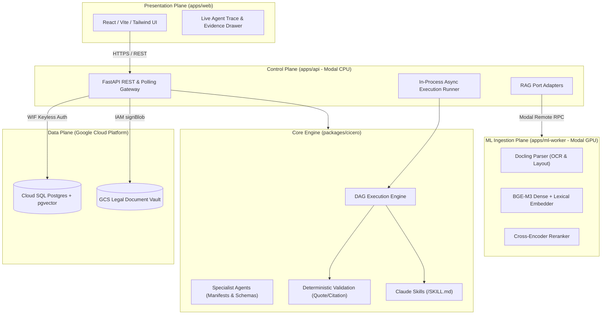
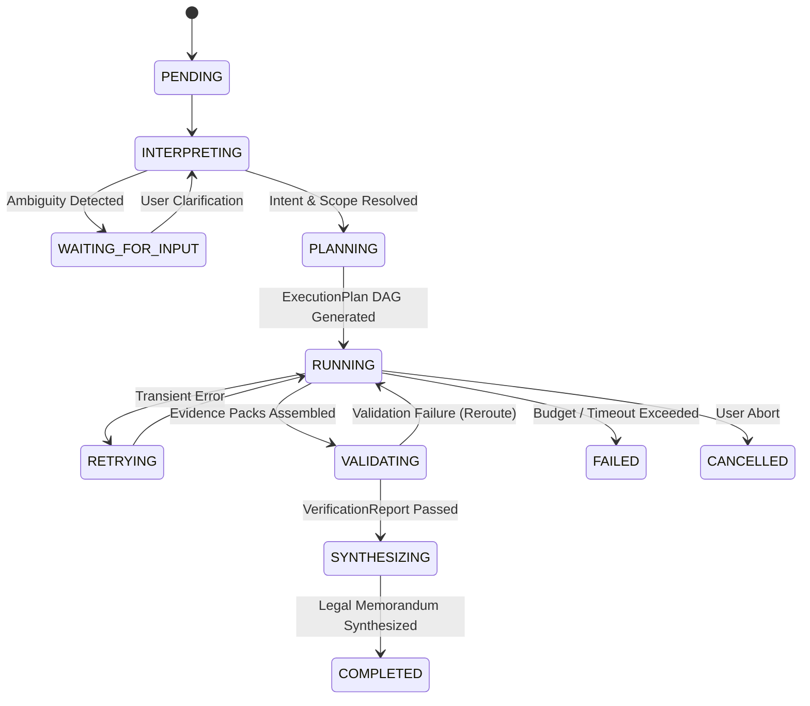

<div align="center">

# ⚖️ Cicero

### Enterprise Multi-Agent Legal Intelligence & Deliberation Platform

[](.github/workflows/ci.yml)
[](pyproject.toml)
[](apps/web/package.json)
[](https://modal.com)
[](deploy/gcp)
[](docs/architecture/repo-layout.md)
[](LICENSE)

<p align="center">
  <b>Cicero</b> is an autonomous multi-agent legal deliberation engine engineered for high-stakes litigation analysis. By combining structure-aware legal document intelligence, adversarial agent deliberation, page-anchored evidence verification, and Claude-style instruction skills, Cicero delivers provably grounded legal memorandums with zero tolerance for hallucinations.
</p>

[Key Features](#key-features) •
[Architecture](#system-architecture) •
[Agent Deliberation Pipeline](#agent-deliberation-pipeline) •
[Claude Skills](#claude-style-skills) •
[Quickstart](#quickstart) •
[Security & WIF](#security--keyless-identity) •
[ADRs](#architectural-decision-records-adrs)

---

</div>

## Overview

Modern Large Language Models produce persuasive legal arguments, but they struggle in high-stakes litigation where factual grounding, controlling authority hierarchies, and exact quote fidelity are paramount.

**Cicero solves this through structural separation and adversarial multi-agent deliberation:**
1. **Evidence Before Opinion:** Agents cannot assert facts without pinned, page-anchored evidence extracted from parsed court pleadings and depositions.
2. **Adversarial Deliberation:** An **Argument Agent** constructs the affirmative case while an independent **Counterargument Agent** (powered by a distinct model family) attacks factual weaknesses, affirmative defenses, and procedural vulnerabilities.
3. **Two-Tier Verification:** Deterministic Python algorithms check quotes and citations before an **Evaluator Agent** judges substantive legal merit.
4. **Claude-Style Skills:** Specialized legal canons and authority classifications are maintained as standalone, versioned `SKILL.md` instruction packages.

---

## Key Features

- **📄 High-Fidelity Legal Ingestion:** Uses [Docling](https://github.com/DS4SD/docling) on GPU workers to parse complex, multi-column legal filings, docket sheets, exhibits, and deposition transcripts (500+ pages) with full OCR and table reconstruction.
- **🔍 Structure-Aware Hybrid RAG:** Combines BAAI BGE-M3 dense and sparse representations with Reciprocal Rank Fusion (RRF), Cross-Encoder re-ranking, and parent-chunk context expansion against PostgreSQL `pgvector`.
- **⚔️ Multi-Model Adversarial Teams:** Eliminates correlated blind spots by pairing **Meta Muse-Spark** for interpretation and synthesis with **DeepSeek-R1 / Llama-3-70B** for adversarial debate.
- **🛡️ Least-Privilege Agent Permissions:** Agents declare requested tools in declarative YAML manifests. The execution harness strictly enforces the intersection $\text{requested} \cap \text{granted}$ defined in central security policies.
- **📐 Mechanical Architectural Boundaries:** Enforced via `import-linter` in CI to guarantee that the core engine remains pure Python (zero PyTorch, zero FastAPI) and specialist agents never bypass the tool layer to touch the database directly.
- **🔑 Zero Long-Lived Credentials:** Employs **Keyless Google Cloud Workload Identity Federation (WIF)** between Modal containers, Cloud SQL, and Cloud Storage signed URLs.

---

## System Architecture

Cicero is architected as a modular monorepo cleanly divided into presentation, control, stateless GPU inference, and a pure Python domain core.



---

## Monorepo Directory Layout

The repository is organized following modern workspace conventions (`uv` for Python workspaces, `pnpm` for TypeScript):

```text
cicero/
├── apps/
│   ├── web/                     # React 18, Vite, Tailwind CSS web application
│   │   ├── src/                 # Interactive chat, case workspace, evidence viewer
│   │   └── types/               # TypeScript interfaces auto-generated from FastAPI OpenAPI
│   ├── api/                     # FastAPI HTTP application & Modal deployment host
│   │   ├── src/cicero_api/      # Routes, dependencies, middleware, and ML port adapters
│   │   └── modal_app.py         # Modal CPU app definition (fastapi_app + runner)
│   └── ml-worker/               # Stateless Modal GPU container (T4 / A10G)
│       ├── src/cicero_ml/       # Docling parsing, BGE-M3 embedding, and Cross-Encoder services
│       └── modal_app.py         # Isolated PyTorch & CUDA dependencies
├── packages/
│   └── cicero/                  # Pure Core Library (Zero PyTorch, Zero FastAPI)
│       ├── src/cicero/
│       │   ├── domain/          # Contracts: AgentResult, EvidenceRef, ExecutionPlan, TaskSpec
│       │   ├── core/            # Config, telemetry, structured logging, error taxonomy
│       │   ├── storage/         # StorageService protocol & GCS WIF implementation
│       │   ├── persistence/     # SQLAlchemy 2.0 async models, connection, repositories
│       │   ├── llm/             # Gateway (concurrency semaphore & 429 backoff) & providers
│       │   ├── rag/             # Ports (protocols), chunking, structural processing, retrieval
│       │   ├── tools/           # Central tool registry, case search, web search
│       │   ├── skills/          # Claude Skills directories (<name>/SKILL.md)
│       │   ├── memory/          # Explicit division: session_memory vs. case_memory
│       │   ├── hooks/           # HookEvent lifecycle bus (pre/post task, tool, validate)
│       │   ├── harness/         # Parallel DAG execution engine & state machine
│       │   │   └── validation/  # Deterministic QuoteMatcher, CitationValidator, EvidenceResolver
│       │   ├── agents/          # Specialized agent manifests (agent.yaml), prompts, and schemas
│       │   └── orchestrator/    # Request interpreter, DAG planner, and brief synthesizer
│       ├── migrations/          # Alembic database migration scripts
│       ├── tests/               # Unit and integration test suites
│       └── .importlinter        # Compile-time architectural boundary contracts
├── config/                      # Declarative system configurations
│   ├── models.yaml              # Multi-model role allocation and concurrency quotas
│   ├── permissions.yaml         # Central security capability matrix
│   ├── workflows.yaml           # Predefined orchestrator DAG execution flows
│   └── platform_context.yaml    # Federal/State court rules, jurisdictions, Bluebook configs
├── evals/                       # Ground-truth benchmarks and retrieval Hit@K evaluations
├── deploy/gcp/                  # Terraform IaC for Cloud SQL pgvector, GCS, and WIF pool
├── docs/                        # Architecture documentation and Architectural Decision Records (ADRs)
├── scripts/                     # Seed scripts, OpenAPI type generation, smoke tests
├── docker-compose.yml           # Local PostgreSQL 16 + pgvector environment
└── pyproject.toml               # uv monorepo workspace configuration
```

---

## Agent Deliberation Pipeline

Cicero rejects the unconstrained "chat loop" approach. Agent executions operate under a deterministic state machine managing a dynamic Directed Acyclic Graph (DAG):



### Specialized Execution Strategies

Following Anthropic's research on effective AI systems, agents use strategies tailored to their cognitive role:

| Specialist Agent | Strategy | Role & Model Allocation | Budget / Guardrail |
| :--- | :--- | :--- | :--- |
| **Request Interpreter** | `single_shot` | Classifies query intent, identifies jurisdiction, requests user clarification if ambiguous (*Meta Muse-Spark*). | 1 turn, strict schema |
| **Legal Researcher** | `tool_loop` | Autonomous budgeted search across uploaded discovery files and external statutory databases (*Llama 3 70B*). | Max 8 turns, token budget |
| **Document Intelligence**| `map_reduce` | Section-level parallel extraction across hundreds of pages (*Llama 3 70B*). | Bounded concurrency cap |
| **Argument Agent** | `single_shot` | Builds the primary legal thesis supported by verified evidence references (*Meta Muse-Spark*). | Grounded input pack |
| **Counterargument Agent**| `single_shot` | Adversarially attacks claims, surfaces contradictory facts and procedural bars (*DeepSeek-R1 / Llama 3*). | Independent model family |
| **Evaluator** | `single_shot` | Evaluates legal strength, controlling authority weight, and sufficiency over a `VerificationReport`. | Zero ungrounded assertions |

---

## Two-Tier Verification

Cicero does not rely on an LLM to check its own work. Verification is bifurcated:

```
┌────────────────────────────────┐
│   Agent Output (Citations)     │
└───────────────┬────────────────┘
                │
                ▼
┌────────────────────────────────────────────────────────┐
│  Tier 1: Deterministic Harness Validation (Python)     │
│  - QuoteMatcher: Exact substring & character matching  │
│  - CitationValidator: Bluebook / Docket format check   │
│  - EvidenceResolver: Validates document IDs in DB      │
└───────────────┬────────────────────────────────────────┘
                │
                ▼ Emits VerificationReport (JSON)
┌────────────────────────────────────────────────────────┐
│  Tier 2: Cognitive Evaluator Agent (LLM)               │
│  - Analyzes legal sufficiency of propositions          │
│  - Weighs binding mandatory vs. persuasive authority   │
│  - Recommends approval or flags evidentiary gaps       │
└────────────────────────────────────────────────────────┘
```

---

## Claude-Style Skills

Cicero implements Anthropic's **Skills Architecture**. Skills are self-contained directory instruction packs containing a `SKILL.md` file with YAML frontmatter specifying activation criteria and instructions.

Example from [`packages/cicero/src/cicero/skills/authority_classification/SKILL.md`](packages/cicero/src/cicero/skills/authority_classification/SKILL.md):

```yaml
---
name: authority_classification
description: Rules and criteria for classifying legal authority into binding mandatory authority versus persuasive secondary authority across US federal and state jurisdictions.
activation:
  - "When researching case law precedents"
  - "When ranking supporting authorities for legal arguments"
  - "When evaluating whether a citation carries controlling weight in the designated venue"
---

# Authority Classification Instructions

## 1. Hierarchy of Authority
1. Mandatory Primary Authority:
   - US Supreme Court precedents on federal constitutional or statutory questions.
   - Circuit Court of Appeals decisions within the target circuit.
   - State Supreme Court decisions on substantive state law issues.
2. Persuasive Primary Authority:
   - Decisions from sister federal circuits or federal district courts.
...
```

The harness dynamic loader reads `activation` patterns and injects the corresponding instructions into the agent's prompt context only when relevant.

---

## Mechanical Boundary Enforcement

To prevent architectural drift, Cicero enforces compilation rules via **Import Linter** contracts in CI ([`packages/cicero/.importlinter`](packages/cicero/.importlinter)):

```ini
[importlinter:contract:core-stays-light]
name = Core must not depend on web, GPU, or Modal SDKs
type = forbidden
source_modules = cicero
forbidden_modules = fastapi, torch, modal, docling

[importlinter:contract:agents-no-direct-data-access]
name = Agents use tools and gateway, never data layers or providers directly
type = forbidden
source_modules = cicero.agents
forbidden_modules = cicero.persistence, cicero.storage, cicero.llm.providers
```

- **`core-stays-light`**: Ensures `packages/cicero` can be installed in lightweight CPU environments and tested in under 2 seconds.
- **`agents-no-direct-data-access`**: Guarantees agents communicate exclusively through tool interfaces, preventing SQL injection and security bypasses.

---

## Security & Keyless Identity

Cicero eliminates long-lived service account JSON keys by using **GCP Workload Identity Federation (WIF)**:

1. **Modal OIDC Issuance:** Modal containers obtain an OpenID Connect (OIDC) identity token issued by `https://oidc.modal.com`.
2. **Federated Token Exchange:** The backend exchanges the Modal token with the GCP STS (Security Token Service) for a short-lived Google OAuth token.
3. **Private Document Storage:** Client browsers upload PDF/DOCX files directly to private Cloud Storage buckets via signed URLs generated using the IAM Credentials `signBlob` API. File bytes never traverse the API gateway.

---

## Quickstart

### Prerequisites
- Python 3.12+ and [uv](https://github.com/astral-sh/uv)
- Node.js 20+ and [pnpm](https://pnpm.io/)
- Docker & Docker Compose (for local PostgreSQL with `pgvector`)
- A [Modal](https://modal.com) account (for cloud deployments)

### 1. Clone & Set Up Workspaces

```bash
git clone https://github.com/your-org/cicero.git
cd cicero

# Install Python workspace dependencies
uv sync

# Install frontend dependencies
pnpm install
```

### 2. Launch Local Database

```bash
docker-compose up -d
```
This spins up PostgreSQL 16 with the `pgvector` extension configured at `localhost:5432`.

### 3. Run Database Migrations

```bash
cd packages/cicero
uv run alembic upgrade head
```

### 4. Run the Test Suite

```bash
# Run lightning-fast unit tests using the fake LLM provider and mock ports
uv run pytest packages/cicero/tests/unit

# Run mechanical boundary enforcement check
uv run lint-imports
```

### 5. Start Development Servers

```bash
# Terminal 1: Backend API (FastAPI)
cd apps/api
uv run uvicorn cicero_api.main:app --reload --port 8000

# Terminal 2: Web UI (Vite + React)
cd apps/web
pnpm dev
```

Visit `http://localhost:5173` to explore the Cicero workspace.

---

## Architectural Decision Records (ADRs)

Key architectural choices are formally documented in [`docs/adr/`](docs/adr/):

| ADR | Title | Status | Rationale Summary |
| :--- | :--- | :--- | :--- |
| **[ADR-0001](docs/adr/0001-fastapi-on-modal.md)** | FastAPI on Modal CPU | Accepted | Eliminates idle infrastructure cost; autoscale down to zero while supporting long async agent executions. |
| **[ADR-0002](docs/adr/0002-provider-independent-model-gateway.md)** | Provider-Independent Model Gateway | Accepted | Unified abstraction supporting Meta Llama API, DeepSeek, and local fake test providers with rate-limiting. |
| **[ADR-0003](docs/adr/0003-cloud-sql-python-connector.md)** | Cloud SQL Asyncpg Connector | Accepted | Native IAM/WIF database connectivity with zero SSL certificate maintenance. |
| **[ADR-0004](docs/adr/0004-workload-identity-federation.md)** | Keyless GCP Workload Identity Federation | Accepted | Strict keyless authentication; zero static service-account JSON keys in production. |
| **[ADR-0005](docs/adr/0005-harness-execution-strategies-and-skills.md)** | Execution Strategies & Claude Skills | Accepted | Avoids generic ReAct loops; matches agents to `tool_loop`, `map_reduce`, or `single_shot`. |
| **[ADR-0006](docs/adr/0006-two-tier-validation-and-evaluation.md)** | Two-Tier Verification Architecture | Accepted | Deterministic Python substring and citation verification before LLM cognitive review. |

---

## Contributing

We welcome contributions from legal technologists, ML engineers, and systems architects. Please review [`SECURITY.md`](SECURITY.md) before submitting security-sensitive pull requests.

1. Fork the repository
2. Create your feature branch (`git checkout -b feature/statutory-graph`)
3. Ensure linter and tests pass (`uv run ruff check . && uv run pytest`)
4. Commit your changes (`git commit -m 'feat: Add statutory graph parser'`)
5. Push to the branch (`git push origin feature/statutory-graph`)
6. Open a Pull Request

---

## License

Cicero is open-source software licensed under the **[Apache License 2.0](LICENSE)**.
