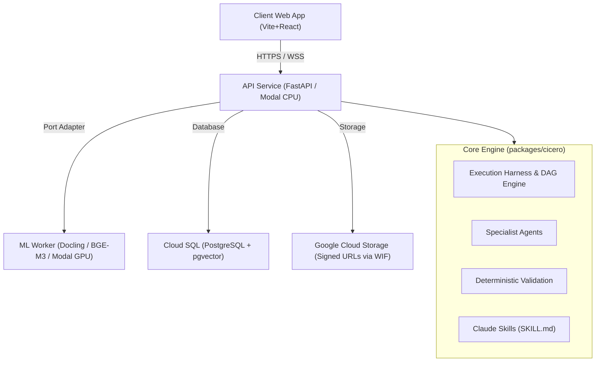

# Cicero Architecture & Repository Layout

## Overview
Cicero is an enterprise-grade multi-agent legal research and deliberation system built using Anthropic's agentic engineering patterns, Claude-style skills, and keyless Google Cloud Platform infrastructure.

## Directory Structure
- **`apps/web`**: Frontend interface built with React, Vite, and Tailwind CSS.
- **`apps/api`**: HTTP service exposing cases, documents, and agent orchestration. Hosts long-running execution orchestrations in-process within the authenticated container.
- **`apps/ml-worker`**: Stateless GPU worker hosting document parsing (Docling), vector embeddings (BGE-M3), and cross-encoder reranking.
- **`packages/cicero`**: Pure Python core library. Strictly decoupled from web frameworks, GPU drivers, and Modal SDKs.
- **`config/`**: Declarative settings for models, permissions, standard workflows, and platform constraints.
- **`evals/`**: Rigorous synthetic benchmark datasets and retrieval accuracy evaluations.
- **`docs/adr/`**: Architectural Decision Records documenting key engineering trade-offs.

## Execution Strategies
Each agent manifests an explicit `execution_strategy`:
- `tool_loop`: Budgeted, iterative ReAct loop for Legal Researcher.
- `map_reduce`: Section-by-section parallel extraction for Document Intelligence.
- `single_shot`: Focused generation over prepared evidence for Argument, Counterargument, and Evaluator.

## Verification Hierarchy
1. **Deterministic Validation (`harness/validation/`)**: Python-level checks for quote matching, citation presence, and evidence resolution. Emits a `VerificationReport`.
2. **Cognitive Evaluation (`agents/evaluator/`)**: LLM judges the legal validity, coherence, and sufficiency of arguments given the verification report.
